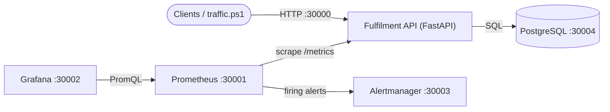

# WalmartOpsDevOps

[](https://github.com/Aay6827/WalmartOpsDevOps/actions/workflows/ci.yml)

A DevOps-focused portfolio project: an omnichannel **order and inventory service** with the delivery and operations tooling around it, namely containers, CI, metrics, dashboards, alerting, runbooks, Kubernetes manifests, Terraform for Azure, and a recorded failure drill with a written RCA.

> Independent portfolio project. It is not affiliated with or endorsed by Walmart. Product names in the seed data are illustrative.

## What this demonstrates

| Area | What is in the repo | Status |
|---|---|---|
| Application | FastAPI service: inventory with stock reservation, order lifecycle state machine, health probes, Prometheus metrics | 22 automated tests passing |
| Containers | Non-root Dockerfile with healthcheck; Docker Compose stack of 5 services | Run and verified locally; exercised end to end in CI |
| CI | GitHub Actions, 5 jobs: unit tests, config validation, compose integration test, Kubernetes manifest validation, Terraform validate | Passing |
| Observability | Prometheus, Alertmanager, Grafana (10-panel dashboard provisioned as code), 6 alert rules | Run and verified locally |
| Reliability | Game-day drill (PostgreSQL outage under load), RCA, 3 runbooks | Executed; evidence committed |
| Kubernetes | Kustomize base: Deployment, HPA, PodDisruptionBudget, StatefulSet, NetworkPolicy, probes, resource limits, non-root and read-only filesystem | Schema-validated in CI; not run on a cluster |
| IaC | Terraform for Azure: AKS, ACR, Log Analytics, AcrPull role | `terraform validate` in CI; not applied to a subscription |

## Architecture



| Port | Service |
|---|---|
| 30000 | Fulfilment API |
| 30001 | Prometheus |
| 30002 | Grafana (dev login: `admin` / `walmartops`) |
| 30003 | Alertmanager |
| 30004 | PostgreSQL |

All credentials in this repo are development placeholders.

## Quick start

Requires Docker Desktop. On Windows PowerShell:

```powershell
docker compose up -d --build
Invoke-RestMethod http://localhost:30000/health/ready

# seed sample SKUs, then generate traffic for 2 minutes
.\scripts\traffic.ps1 -Mode seed
.\scripts\traffic.ps1 -Mode normal -Seconds 120
```

Then open Grafana at http://localhost:30002/d/walmartops-overview and the API docs at http://localhost:30000/docs.

Run the tests without Docker:

```powershell
py -3.12 -m venv .venv
.\.venv\Scripts\Activate.ps1
pip install -r requirements.txt
python -m pytest
```

## API

| Method | Path | Purpose |
|---|---|---|
| POST | `/inventory` | Create or update a SKU |
| GET | `/inventory`, `/inventory/{sku}` | List or read stock (`on_hand`, `reserved`, `available`) |
| POST | `/orders` | Create an order; reserves stock all-or-nothing (409 if insufficient) |
| GET | `/orders`, `/orders/{id}` | List or read orders |
| PATCH | `/orders/{id}/status` | Move an order through `CREATED > PICKING > PACKED > SHIPPED > DELIVERED`, or cancel before shipping |
| GET | `/health/live`, `/health/ready` | Liveness (process) and readiness (database) probes |
| GET | `/metrics` | Prometheus metrics |

Stock rules: reservation happens at order creation, cancellation releases it, shipping deducts `on_hand`. Invalid state transitions return 409.

## Observability

Custom metrics: `http_requests_total`, `http_request_duration_seconds`, `orders_created_total`, `order_status_changes_total`, `inventory_reservation_failures_total`, `inventory_low_stock_skus`, `db_up`.

| Alert | Condition | Severity |
|---|---|---|
| `ApiDown` | Target not scrapable for 1m | critical |
| `DatabaseDown` | `db_up == 0` for 30s | critical |
| `HighErrorRate` | 5xx ratio above 5% (5m window) for 2m | critical |
| `HighLatencyP95` | p95 above 500 ms for 5m | warning |
| `LowStockSkus` | Any SKU at or below threshold for 5m | warning |
| `ReservationFailureSpike` | More than 10 stock rejections in 10m | warning |

Design note: `/metrics` deliberately keeps working when PostgreSQL is down and reports `db_up 0`. An earlier design queried the database inside the metrics handler, which would have blinded monitoring during exactly the outage it should report.

## Game-day drill: PostgreSQL outage

PostgreSQL was stopped for 226 seconds under continuous synthetic traffic (`scripts/incident_drill.ps1`). Full write-up: [`docs/rca/2026-10-19-postgres-outage-drill.md`](docs/rca/2026-10-19-postgres-outage-drill.md), raw evidence: [`docs/rca/drill-2026-10-19-evidence.txt`](docs/rca/drill-2026-10-19-evidence.txt).

| Measurement | Result |
|---|---|
| `DatabaseDown` fired | 76 s after fault |
| `HighErrorRate` fired | 226 s after fault |
| `ApiDown` | Did not fire (correct: process stayed up) |
| API recovery after PostgreSQL restart | 4 s, no API restart |

The RCA also lists what went poorly (slow error-rate alert, no notification receiver, noise from seed data) with six follow-up actions.

Runbooks: [`database-down`](docs/runbooks/database-down.md), [`high-error-rate`](docs/runbooks/high-error-rate.md), [`api-down`](docs/runbooks/api-down.md).

## CI

`.github/workflows/ci.yml` runs on every push and pull request:

1. **Unit tests**: pytest on Python 3.12.
2. **Config validation**: `promtool check config` (including alert rules), `docker compose config`, Grafana dashboard JSON, YAML parse.
3. **Integration**: builds and starts the real compose stack, creates an order end to end, checks `db_up 1` and that Prometheus scrapes the API.
4. **Kubernetes manifests**: renders the kustomization and schema-validates it with kubeconform.
5. **Terraform validate**: `init -backend=false` and `validate` (the format check is advisory).

## Kubernetes

```powershell
kubectl kustomize k8s          # render
kubectl apply -k k8s           # deploy to a cluster (build or load the API image first)
```

The API Deployment runs 2 replicas with startup, readiness and liveness probes, requests and limits, a non-root user, a read-only root filesystem and dropped capabilities. An HPA scales 2 to 6 replicas on CPU, a PodDisruptionBudget keeps one pod up during voluntary disruptions, and a NetworkPolicy restricts PostgreSQL to the API pods. The NodePort Service on 30000 is a local convenience; use an Ingress or LoadBalancer on a cloud cluster. Secrets here are placeholders; use Key Vault or External Secrets for real deployments.

## Terraform

See [`terraform/README.md`](terraform/README.md). It is validated in CI but has not been applied, because an AKS cluster costs money.

## Repository layout

```
app/            FastAPI service (models, schemas, metrics, routes)
tests/          pytest suite (orders, inventory, lifecycle, health, resilience)
docker/         Dockerfile
monitoring/     Prometheus rules and config, Alertmanager, Grafana provisioning and dashboard
k8s/            Kustomize manifests
terraform/      Azure AKS, ACR, Log Analytics
scripts/        traffic generator and incident drill
docs/           RCA, drill evidence, runbooks
.github/        CI workflow
```

## Known gaps and next steps

- Alertmanager has no notification receiver configured (RCA action 2).
- Add a fast-burn error alert with a short window (RCA action 1) and re-run the drill to compare timings.
- Set database connection and pool timeouts so requests fail fast during an outage (RCA action 4).
- Remote Terraform state, per-environment configuration and `terraform plan` on pull requests.
- Container image build and push to a registry from CI, then deploy.
- Database migrations (the app currently creates tables at startup).